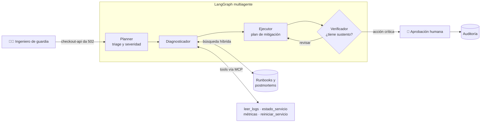

# runbook-agent 🚨🤖

> Copiloto de IA para ingenieros de guardia (SRE/DevOps): diagnostica incidentes consultando
> runbooks, postmortems y logs, propone un plan de mitigación y **solo ejecuta acciones críticas
> con aprobación humana**.


## El problema

Son las 3 a. m. y suena la alerta: `checkout-api` devuelve errores 502 y los usuarios no pueden
pagar. El ingeniero de guardia tiene que encontrar el runbook correcto entre decenas, revisar logs y
métricas, recordar si esto ya pasó antes y decidir si es seguro hacer un rollback, todo bajo presión.

Los runbooks y postmortems guardan el conocimiento del equipo, pero **encontrar y aplicar la
información correcta en el momento justo** es lento y propenso a errores.

## La solución (objetivo)

`runbook-agent` actúa como un ingeniero de guardia experto que leyó toda la documentación operativa
del equipo:

1. **Entiende el incidente** a partir de un mensaje libre y estima su severidad (SEV1–SEV4).
2. **Busca** los runbooks y postmortems relevantes (RAG híbrido: semántico + palabras clave, para
   códigos de error exactos como `OOMKilled`).
3. **Investiga** con herramientas: lee logs, revisa el estado y las métricas de los servicios.
4. **Propone** un diagnóstico y un plan **citando sus fuentes**.
5. **Pide aprobación humana** antes de cualquier acción destructiva (reinicio, rollback) y deja
   un registro de auditoría.

## Arquitectura (objetivo)



## Roadmap

El proyecto se construye de forma incremental, una capa por etapa:

- [x] **Cliente LLM multi-proveedor** (Groq / Gemini) con métricas de tokens, latencia y costo por llamada
- [x] **Análisis de tokens y costo**: conteo local con tiktoken, presupuestos por feature y streaming con TTFT
- [ ] Clasificación de severidad con prompts versionados y evaluados contra un golden set
- [ ] Contratos con Pydantic y function calling
- [ ] RAG sobre runbooks y postmortems: ingesta, chunking y ChromaDB
- [ ] RAG avanzado: búsqueda híbrida (BM25 + embeddings), reranking y compresión
- [ ] RAG en producción: reindexado incremental, permisos por equipo y caché semántico
- [ ] Soporte para modelos locales (los logs de producción son sensibles)
- [ ] Tools de infraestructura y pipeline de triage
- [ ] Agente ReAct con traza de razonamiento
- [ ] Multiagente con LangGraph (planner → diagnosticador → ejecutor → verificador)
- [ ] Memoria por incidente + human-in-the-loop + auditoría
- [ ] Tools expuestas como servidor MCP
- [ ] Tests: contratos, golden tests y replay de incidentes
- [ ] Evals: faithfulness, context precision/recall y tool accuracy; optimización con DSPy
- [ ] Guardrails (prompt injection en logs, secretos/PII), observabilidad con Phoenix y deploy

## Decisiones técnicas

### Cliente LLM independiente del proveedor
Todo el sistema habla con un único `LLMClient` (`core/llm_client.py`) que devuelve un `LLMResponse`
tipado. Groq y Gemini se usan mediante su **API compatible con OpenAI**, así que cambiar de proveedor
es **una línea en `.env`**, sin tocar código. Esto también deja un único lugar donde agregar
reintentos, fallback entre proveedores, caché o trazas.

### Medir cada llamada desde el día uno
Cada llamada registra tokens de entrada y salida, latencia y costo estimado:

```
llm_call | provider=groq | model=openai/gpt-oss-120b | prompt_tokens=113 | completion_tokens=68 | ttft_ms=- | latency_ms=857 | cost_usd=0.000058
```

Tokens, latencia y costo deciden si un sistema de IA es viable en producción; lo que no se mide no
se puede optimizar.

### El precio por token no dice cuánto vas a pagar
Con exactamente el mismo prompt, cada modelo contó una cantidad distinta de tokens de entrada:

| Modelo | Tokens de entrada (mismo prompt) |
|---|---|
| `openai/gpt-oss-120b` | 113 |
| `qwen/qwen3.8-27b` | 57 |

Cada familia tiene su propio tokenizador, y algunos modelos agregan un formato interno a cada
petición. Además, los modelos de razonamiento gastan tokens de salida que no se ven. **Para comparar
costos hay que medir con prompts reales, no solo comparar tarifas.**

### Versiones de modelo fijas, nunca alias `latest`
Los proveedores retiran modelos (un modelo que existía devolvió `404 model_not_found`) y los alias
como `gemini-flash-latest` cambian de modelo sin aviso. Por eso el modelo se fija a una versión
concreta en la configuración y solo se cambia a propósito, después de evaluar.

### Los proveedores fallan: timeouts y reintentos explícitos
En una sola sesión de pruebas aparecieron un `404` (modelo retirado), **164 s de latencia** por
saturación con reintentos automáticos y un `500 Internal error` del proveedor. El SDK espera hasta
10 minutos por defecto, inaceptable durante un incidente. Por eso el timeout y el número de
reintentos son configuración explícita (`LLM_TIMEOUT_S`, `LLM_MAX_RETRIES`), y el paso siguiente
es un fallback automático entre proveedores.

### Groq como proveedor principal: latencia medida
Mismo laboratorio en streaming (`scripts/tokenlab_lab.py`), resumiendo un runbook de distintos tamaños:

| Tokens de entrada | Groq `gpt-oss-120b`: TTFT / total | Gemini `gemma-4-26b-a4b-it`: TTFT / total |
|---|---|---|
| ~150 | 675 ms / 764 ms | 1441 ms / 3272 ms |
| ~1400 | 873 ms / 946 ms | 1082 ms / 1989 ms |
| ~5300 | 1035 ms / 1142 ms | 1739 ms / 2420 ms |

En Groq, cada respuesta completa tardó alrededor de 1 s, incluso con un límite de salida 4 veces
mayor (400 tokens contra 100). En Gemma, una respuesta de chat de 212 tokens tardó **17,5 s**.
Durante un incidente cada segundo cuenta, así que Groq es el proveedor principal y Gemini queda
como respaldo. Con Groq también se ve que el TTFT crece con el input (de 675 a 1035 ms): el modelo
procesa todo el prompt antes de escribir el primer token.

### Los modelos que razonan gastan tokens que no se ven
Con `max_tokens=100`, `gpt-oss-120b` se gastó todo el límite **pensando** y devolvió una respuesta
vacía (`finish_reason="length"`). Gemma, en cambio, mezcla su razonamiento (`<thought>...`) en el
texto de la respuesta. Ese razonamiento cuenta en el límite de salida, en el costo y en la latencia:
el TTFT medido incluye el tiempo de pensar, y los tokens por segundo salen inflados. Por eso el
cliente revisa `finish_reason` y, si se agotó el límite, explica la causa en vez de un genérico
"respuesta vacía". Los presupuestos de salida se dimensionan pensando en el razonamiento.

### Temperatura 0 para clasificar
La misma consulta ("el login falla para el 30 % de los usuarios desde hace 5 minutos"), 3 veces:

| Temperatura | Severidades obtenidas |
|---|---|
| 0.0 | SEV2 · SEV2 · SEV2 (respuestas idénticas) |
| 1.2 | SEV2 · **SEV1** · SEV2 |

En un clasificador de severidad, esa variación significa despertar a alguien a las 3 a. m. por azar.
Las tareas de clasificación y decisión usan temperatura 0; la variabilidad queda para tareas
abiertas, como redactar un resumen.

### El costo está en el contexto, no en el prompt
Anatomía de un request con RAG, contada localmente con tiktoken antes de llamar al modelo:

| Parte | Tokens |
|---|---|
| System prompt | 38 |
| Runbook recuperado (RAG) | 961 (95 %) |
| Pregunta del usuario | 11 |

Con ~500 tokens de salida y los precios de `gpt-oss-120b`, eso proyecta **$1.35 al mes con 100
consultas al día y ~$1 350 con 100 000**. Para bajar el costo hay que optimizar lo que trae el RAG,
no recortar el prompt.

Por eso cada feature tiene un **presupuesto de tokens** (`core/tokenlab.py`). El input se valida
**antes** de gastar un solo token: un request de ~1300 tokens se rechaza en `clasificar_severidad`
(máximo 500), pero cabe en `responder_con_runbook` (máximo 4000).

| Feature | Máx. entrada | Máx. salida |
|---|---|---|
| `chat_general` | 2 000 | 800 |
| `clasificar_severidad` | 500 | 50 |
| `responder_con_runbook` | 4 000 | 800 |
| `diagnostico_agente` | 15 000 | 2 000 |

El conteo local es exacto para `gpt-oss`, porque tiktoken incluye su tokenizador (`o200k_harmony`),
y aproximado para otros modelos: con Gemma, la diferencia medida fue de ~3 %.

### Configuración que falla rápido
`core/config.py` valida la configuración al arrancar: si falta una API key o un valor es inválido,
el programa se detiene con un mensaje claro, en vez de fallar a mitad de una petición.

## Stack

| Área | Tecnología |
|---|---|
| Lenguaje y dependencias | Python 3.12, [uv](https://docs.astral.sh/uv/) |
| LLMs | Groq (`openai/gpt-oss-120b`), Google Gemini — vía API compatible con OpenAI |
| Tokens | tiktoken (conteo local antes de llamar al modelo) |
| Logging | `logging` + Rich |
| Calidad de código | ruff |
| Próximamente | ChromaDB, LangGraph, Pydantic, MCP, pytest, DSPy, Arize Phoenix, Streamlit, Docker |

## Cómo correrlo

Requisitos: [uv](https://docs.astral.sh/uv/getting-started/installation/) y una API key gratuita de
[Groq](https://console.groq.com/keys) o de [Google AI Studio](https://aistudio.google.com/apikey).

```bash
git clone https://github.com/killerwilmer/runbook-agent.git
cd runbook-agent
uv sync                     # crea el entorno e instala dependencias exactas (uv.lock)
cp .env.example .env        # y completa tu API key
uv run main.py              # chat con streaming y métricas
uv run python -m scripts.tokenlab_lab   # laboratorio de tokens, costo, latencia y temperatura
```

### Configuración (`.env`)

| Variable | Descripción | Por defecto |
|---|---|---|
| `LLM_PROVIDER` | `groq` o `gemini` | `groq` |
| `LLM_MODEL` | Modelo del proveedor elegido (versión fija) | `openai/gpt-oss-120b` |
| `LLM_TEMPERATURE` | Temperatura de muestreo | `0.2` |
| `LLM_TIMEOUT_S` | Segundos máximos de espera por llamada | `30` |
| `LLM_MAX_RETRIES` | Reintentos ante errores temporales | `2` |
| `GROQ_API_KEY` / `GEMINI_API_KEY` | API key del proveedor elegido | — |
| `INPUT_COST_PER_1M_TOKENS` / `OUTPUT_COST_PER_1M_TOKENS` | Precio en USD por millón de tokens, para estimar costos | `0` |
| `LOG_LEVEL` | `DEBUG`, `INFO`, `WARNING` o `ERROR` | `INFO` |

## Estructura

```
runbook-agent/
├── core/
│   ├── config.py       # configuración desde .env, validada al arrancar
│   ├── logger.py       # logging con niveles (Rich)
│   ├── llm_client.py   # cliente LLM multi-proveedor: chat y streaming con métricas
│   └── tokenlab.py     # conteo de tokens, proyección de costos y presupuestos por feature
├── scripts/
│   └── tokenlab_lab.py # experimentos medibles de tokens, costo, latencia y temperatura
├── main.py             # punto de entrada (CLI) con streaming y control de presupuesto
├── .env.example        # variables necesarias, sin secretos
└── pyproject.toml
```

## Autor

**Wilmer Arteaga** — construyendo `runbook-agent` como proyecto del bootcamp *AI Engineer con
Python* de Código Facilito.

[GitHub](https://github.com/killerwilmer) · [LinkedIn](https://www.linkedin.com/in/killerwilmer/)
