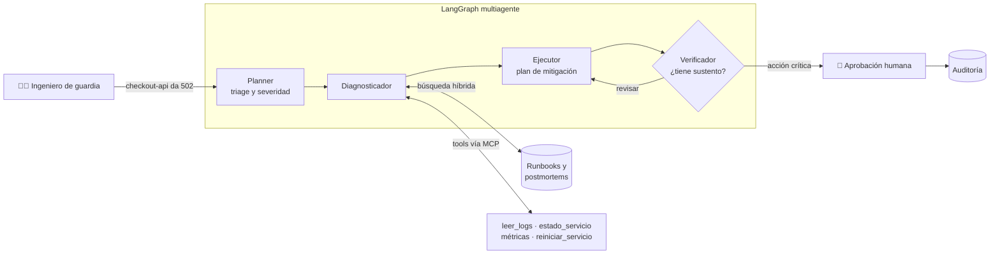

# runbook-agent 🚨🤖

> Copiloto de IA para ingenieros de guardia (SRE/DevOps): diagnostica incidentes consultando
> runbooks, postmortems y logs, propone un plan de mitigación y **solo ejecuta acciones críticas
> con aprobación humana**.


## El problema

Son las 3 a. m. y suena la alerta: `checkout-api` devuelve errores 502 y los usuarios no pueden
pagar. El ingeniero de guardia tiene que encontrar el runbook correcto entre decenas, revisar logs y
métricas, recordar si esto ya pasó antes y decidir si es seguro hacer un rollback, todo bajo presión.

Los runbooks y postmortems guardan el conocimiento del equipo, pero **encontrar y aplicar la
información correcta en el momento justo** es lento y propenso a errores.

## La solución (objetivo)

`runbook-agent` actúa como un ingeniero de guardia experto que leyó toda la documentación operativa
del equipo:

1. **Entiende el incidente** a partir de un mensaje libre y estima su severidad (SEV1–SEV4).
2. **Busca** los runbooks y postmortems relevantes (RAG híbrido: semántico + palabras clave, para
   códigos de error exactos como `OOMKilled`).
3. **Investiga** con herramientas: lee logs, revisa el estado y las métricas de los servicios.
4. **Propone** un diagnóstico y un plan **citando sus fuentes**.
5. **Pide aprobación humana** antes de cualquier acción destructiva (reinicio, rollback) y deja
   un registro de auditoría.

## Arquitectura (objetivo)



## Roadmap

El proyecto se construye de forma incremental, una capa por etapa:

- [x] **Cliente LLM multi-proveedor** (Groq / Gemini) con métricas de tokens, latencia y costo por llamada
- [x] **Análisis de tokens y costo**: conteo local con tiktoken, presupuestos por feature y streaming con TTFT
- [x] **Clasificación de severidad** con prompts versionados y evaluados contra un golden set
- [x] **Contratos con Pydantic y function calling**: extracción estructurada de incidentes y primera tool de infraestructura (simulada)
- [ ] RAG sobre runbooks y postmortems: ingesta, chunking y ChromaDB
- [ ] RAG avanzado: búsqueda híbrida (BM25 + embeddings), reranking y compresión
- [ ] RAG en producción: reindexado incremental, permisos por equipo y caché semántico
- [ ] Soporte para modelos locales (los logs de producción son sensibles)
- [ ] Tools de infraestructura y pipeline de triage
- [ ] Agente ReAct con traza de razonamiento
- [ ] Multiagente con LangGraph (planner → diagnosticador → ejecutor → verificador)
- [ ] Memoria por incidente + human-in-the-loop + auditoría
- [ ] Tools expuestas como servidor MCP
- [ ] Tests: contratos, golden tests y replay de incidentes
- [ ] Evals: faithfulness, context precision/recall y tool accuracy; optimización con DSPy
- [ ] Guardrails (prompt injection en logs, secretos/PII), observabilidad con Phoenix y deploy

## Decisiones técnicas

### Cliente LLM independiente del proveedor
Todo el sistema habla con un único `LLMClient` (`core/llm_client.py`) que devuelve un `LLMResponse`
tipado. Groq y Gemini se usan mediante su **API compatible con OpenAI**, así que cambiar de proveedor
es **una línea en `.env`**, sin tocar código. Esto también deja un único lugar donde agregar
reintentos, fallback entre proveedores, caché o trazas.

### Medir cada llamada desde el día uno
Cada llamada registra tokens de entrada y salida, latencia y costo estimado:

```
llm_call | provider=groq | model=openai/gpt-oss-120b | prompt_tokens=113 | completion_tokens=68 | ttft_ms=- | latency_ms=857 | cost_usd=0.000058
```

Tokens, latencia y costo deciden si un sistema de IA es viable en producción; lo que no se mide no
se puede optimizar.

### El precio por token no dice cuánto vas a pagar
Con exactamente el mismo prompt, cada modelo contó una cantidad distinta de tokens de entrada:

| Modelo | Tokens de entrada (mismo prompt) |
|---|---|
| `openai/gpt-oss-120b` | 113 |
| `qwen/qwen3.8-27b` | 57 |

Cada familia tiene su propio tokenizador, y algunos modelos agregan un formato interno a cada
petición. Además, los modelos de razonamiento gastan tokens de salida que no se ven. **Para comparar
costos hay que medir con prompts reales, no solo comparar tarifas.**

### Versiones de modelo fijas, nunca alias `latest`
Los proveedores retiran modelos (un modelo que existía devolvió `404 model_not_found`) y los alias
como `gemini-flash-latest` cambian de modelo sin aviso. Por eso el modelo se fija a una versión
concreta en la configuración y solo se cambia a propósito, después de evaluar.

### Los proveedores fallan: timeouts y reintentos explícitos
En una sola sesión de pruebas aparecieron un `404` (modelo retirado), **164 s de latencia** por
saturación con reintentos automáticos y un `500 Internal error` del proveedor. El SDK espera hasta
10 minutos por defecto, inaceptable durante un incidente. Por eso el timeout y el número de
reintentos son configuración explícita (`LLM_TIMEOUT_S`, `LLM_MAX_RETRIES`), y el paso siguiente
es un fallback automático entre proveedores.

### Groq como proveedor principal: latencia medida
Mismo laboratorio en streaming (`scripts/tokenlab_lab.py`), resumiendo un runbook de distintos tamaños:

| Tokens de entrada | Groq `gpt-oss-120b`: TTFT / total | Gemini `gemma-4-26b-a4b-it`: TTFT / total |
|---|---|---|
| ~150 | 675 ms / 764 ms | 1441 ms / 3272 ms |
| ~1400 | 873 ms / 946 ms | 1082 ms / 1989 ms |
| ~5300 | 1035 ms / 1142 ms | 1739 ms / 2420 ms |

En Groq, cada respuesta completa tardó alrededor de 1 s, incluso con un límite de salida 4 veces
mayor (400 tokens contra 100). En Gemma, una respuesta de chat de 212 tokens tardó **17,5 s**.
Durante un incidente cada segundo cuenta, así que Groq es el proveedor principal y Gemini queda
como respaldo. Con Groq también se ve que el TTFT crece con el input (de 675 a 1035 ms): el modelo
procesa todo el prompt antes de escribir el primer token.

### Los modelos que razonan gastan tokens que no se ven
Con `max_tokens=100`, `gpt-oss-120b` se gastó todo el límite **pensando** y devolvió una respuesta
vacía (`finish_reason="length"`). Gemma, en cambio, mezcla su razonamiento (`<thought>...`) en el
texto de la respuesta. Ese razonamiento cuenta en el límite de salida, en el costo y en la latencia:
el TTFT medido incluye el tiempo de pensar, y los tokens por segundo salen inflados. Por eso el
cliente revisa `finish_reason` y, si se agotó el límite, explica la causa en vez de un genérico
"respuesta vacía". Los presupuestos de salida se dimensionan pensando en el razonamiento.

### Temperatura 0 para clasificar
La misma consulta ("el login falla para el 30 % de los usuarios desde hace 5 minutos"), 3 veces:

| Temperatura | Severidades obtenidas |
|---|---|
| 0.0 | SEV2 · SEV2 · SEV2 (respuestas idénticas) |
| 1.2 | SEV2 · **SEV1** · SEV2 |

En un clasificador de severidad, esa variación significa despertar a alguien a las 3 a. m. por azar.
Las tareas de clasificación y decisión usan temperatura 0; la variabilidad queda para tareas
abiertas, como redactar un resumen.

### El costo está en el contexto, no en el prompt
Anatomía de un request con RAG, contada localmente con tiktoken antes de llamar al modelo:

| Parte | Tokens |
|---|---|
| System prompt | 38 |
| Runbook recuperado (RAG) | 961 (95 %) |
| Pregunta del usuario | 11 |

Con ~500 tokens de salida y los precios de `gpt-oss-120b`, eso proyecta **$1.35 al mes con 100
consultas al día y ~$1 350 con 100 000**. Para bajar el costo hay que optimizar lo que trae el RAG,
no recortar el prompt.

Por eso cada feature tiene un **presupuesto de tokens** (`core/tokenlab.py`). El input se valida
**antes** de gastar un solo token: un request de ~1300 tokens se rechaza en `clasificar_severidad`
(máximo 1 000), pero cabe en `responder_con_runbook` (máximo 4 000).

| Feature | Máx. entrada | Máx. salida |
|---|---|---|
| `chat_general` | 2 000 | 800 |
| `clasificar_severidad` | 1 000 | 500 |
| `responder_con_runbook` | 4 000 | 800 |
| `diagnostico_agente` | 15 000 | 2 000 |
| `extraer_incidente` | 1 500 | 1 200 |

El conteo local es exacto para `gpt-oss`, porque tiktoken incluye su tokenizador (`o200k_harmony`),
y aproximado para otros modelos: con Gemma, la diferencia medida fue de ~3 %.

### Prompts como código, evaluados contra un golden set
Los prompts viven en `prompting/` como plantillas con **nombre y versión** en un registro central. Una
versión publicada no se modifica: cualquier cambio es una versión nueva, con su propia evaluación.
Cada versión se mide contra un golden set de 20 incidentes etiquetados
(`data/golden/severidad.json`), que incluye casos en inglés, jerga de Kubernetes y un *prompt
injection* escondido en un log.

Resultados con `gpt-oss-120b` y temperatura 0 (`scripts/eval_severidad.py`):

| Versión | Qué agrega | Accuracy | Subestimados | Tokens/llamada | Costo (20 casos) |
|---|---|---|---|---|---|
| v1 | Pide SEV1–SEV4 en JSON, sin criterios | 80 % | 0 | 305 | $0.0023 |
| v2 | Rol + rúbrica SEV + servicios críticos + delimitadores | 90 % | 2 | 610 | $0.0034 |
| **v3** | v2 + restricciones + 4 ejemplos (*few-shot*) | **95 %** | **1** | 904 | $0.0042 |
| v4 | Cadena de 2 prompts: extraer hechos → clasificar | 85 % | 2 | 1505 | $0.0089 |

Lo que mostraron los datos:

- **La accuracy sola engaña.** Sin rúbrica (v1), los 4 errores fueron **sobreestimaciones**. Con la
  rúbrica (v2), la accuracy subió, pero aparecieron **subestimaciones**, el error caro: un SEV1
  tratado como SEV3 deja la tienda caída. Por eso el evaluador mide los subestimados aparte, y entre
  dos versiones parecidas gana la que subestima menos.
- **La cadena no pagó su costo.** v4 gastó 1,7 veces los tokens de v3 y el doble de latencia, y
  acertó menos: el paso de extracción pierde matices (por ejemplo, si los afectados son usuarios
  internos). Dividir en pasos no es mejor por defecto; se mide.
- **Un fallo que se repite en todas las versiones apunta a la rúbrica, no al prompt.** `search-service`
  caído para todos, con rodeo, falló en v2, v3 y v4: la rúbrica permite leerlo como SEV2 ("función
  importante caída con rodeo") o como SEV3 ("servicio no crítico"). Se corrige aclarando el criterio,
  no ajustando el prompt hasta que acierte.
- **El *prompt injection* no funcionó** en ninguna versión: el incidente va delimitado como datos
  (`<incidente>...</incidente>`). Es un solo caso; los guardrails dedicados vienen después.
- **Con 20 casos, cada caso vale 5 puntos**: v3 es la versión en uso, pero la diferencia con v2 es un
  solo caso. El siguiente paso es ampliar el golden set antes de afirmar más.

El presupuesto de tokens de `clasificar_severidad` se ajustó con estas mediciones: el prompt v3 usa
~670 tokens de entrada, y gpt-oss gasta la mayor parte de la salida razonando (~190 de ~220 tokens
para devolver un JSON de ~25).

### Contratos con Pydantic: la forma garantizada, el criterio no
El resto del sistema no lee prosa del modelo: lee un objeto `Incidente` (`contracts/incidente.py`)
con servicio, síntoma, porcentaje de usuarios, pérdida de datos o dinero, severidad y justificación.
El JSON Schema se genera desde Pydantic, viaja al proveedor como *structured output* y la respuesta
se valida igual al volver. Si no cumple, el error de validación se le devuelve al modelo y se
reintenta (`LLMClient.parse()`). Las reglas entre campos que JSON Schema no puede expresar viven en
un `@model_validator`: **pérdida de datos o dinero en un servicio crítico siempre es SEV1**.

Evaluado contra el mismo golden set (`--prompt extraer_incidente --versiones 1`):

| Prompt | Qué hace | Accuracy | Subestimados | JSON válido | Tokens/caso | Costo (20 casos) |
|---|---|---|---|---|---|---|
| `clasificar_severidad@v3` | Solo severidad, con 4 ejemplos | 95 % | 1 | — | 904 | $0.0042 |
| `extraer_incidente@v1` | Contrato completo (6 campos), sin ejemplos | 70 % | 3 | **20/20** | 1345 | $0.0078 |

Lo que mostraron los datos:

- **El contrato garantizó la forma: 20/20 respuestas válidas.** Nada del sistema se rompe por un
  JSON mal formado.
- **El criterio empeoró.** v1 no tiene los ejemplos de v3 y hace más trabajo (6 campos en vez de
  2). Un contrato no reemplaza al prompt: lo que mejora la clasificación sigue siendo el prompt. El
  siguiente paso es una v2 con ejemplos *few-shot*.
- **Una regla de negocio puede empujar hacia la sobreestimación.** Dos fallos fueron SEV2 → SEV1 en
  `payments-api` ("rechaza pagos con Amex", "un pod de tres en CrashLoopBackOff"). El modelo marcó
  pérdida de dinero, y con eso la regla solo acepta SEV1. Además, el mensaje de error del validador
  sugiere una sola corrección (subir la severidad), no revisar si de verdad hay pérdida. La
  definición de "pérdida de dinero" tiene que quedar escrita en la `description` del campo.
- **Los 3 subestimados son servicios no críticos** (`search-service` vacío para todos,
  `admin-dashboard` lento, `reports-batch` caído): sin ejemplos, el modelo asocia "no crítico" con
  "poco grave". `search-service` también había fallado en las versiones de PromptKit.
- **El esquema cuesta tokens que el conteo local no ve.** `count_message_tokens` estima ~383 tokens
  de entrada, pero el proveedor reporta ~826: el esquema viaja en cada request. Por eso
  `extraer_incidente` tiene su propio presupuesto (1 500 de entrada, 1 200 de salida).

La demo ya usa `extraer_incidente@v2` (v1 + 4 ejemplos en formato de contrato). En sus 3 reportes,
el caso ambiguo ("a varios compañeros no les deja entrar") no fue estable con v1: salió SEV2 en una
corrida y SEV3 en otra, justificado con un *"menos del 10 % de usuarios"* que el modelo inventó (el
campo de usuarios era `null`). Con v2 salió SEV2, justificado solo con lo que dice el reporte. Los ejemplos
suben la entrada de ~850 a ~1 230 tokens por request. Son 3 casos: la comparación que vale es
`--prompt extraer_incidente --versiones 1 2` sobre el golden set completo.

### "No sé" no es un valor del enum
El servicio de un incidente es `Servicio | None`: `null` cuando el reporte no lo dice. Al principio
era un noveno miembro, `Servicio.DESCONOCIDO`, y eso abrió un bug: las tools reutilizan el enum para
sus argumentos, así que el JSON Schema le ofrecía al modelo consultar el servicio `"desconocido"`.
La validación lo aceptaba y la función fallaba con un `KeyError` que tumbaba el chat. Con `None`,
`Servicio` solo contiene servicios que existen, y sigue siendo la única fuente de verdad para el
contrato, las tools y los prompts. Los datos simulados se comprueban contra él al cargarse: si falta
un servicio, el error aparece en la primera consulta y dice cuál falta.

### Function calling: el modelo propone, el código ejecuta
Las tools (`tools/`) se declaran con un modelo Pydantic para sus argumentos y otro para su resultado:
el JSON Schema que ve el modelo y la validación salen de la misma fuente. El modelo **pide** la tool,
el código valida los argumentos y la ejecuta, y un argumento inválido (`"servicio": "pagos"`) vuelve
al modelo como error en JSON, sin excepción. El bucle `chat_con_tools()` tiene un máximo de rondas:
es el primer control de costo de un agente.

En la demo (`scripts/demo_contratos.py`), ante "reportan errores al pagar en checkout-api", el modelo
decidió consultar `estado_servicio` y respondió con datos que solo existen en el estado simulado
(2/3 pods, 12.5 % de errores, un pod `OOMKilled`).

Con una segunda tool, `leer_logs(servicio, ultimos_minutos)`, y la pregunta "¿por qué falla
checkout-api?", el modelo encadenó las dos en orden: estado y después logs (3 llamadas, 2 tools). La
ventana se limita a `1-60` minutos en el contrato (`Field(ge=1, le=60)`) y a 50 líneas en la
función, porque cada línea de log son tokens. Lo que mostraron dos corridas iguales:

- **El modelo decide los argumentos, y un argumento razonable puede esconder la evidencia.** Pidió
  `ultimos_minutos=10` y la ventana empezó a las 14:20. Quedaron fuera el deploy de v2.14.0 (14:05)
  y los `OOMKilled`, mientras que los pods sanos seguían en v2.13.2. La respuesta habló de memoria y
  de reiniciar el pod, sin conectar el problema con el deploy, cuando la evidencia apunta a un
  rollback.
- **El modelo no tiene reloj.** `estado_servicio` le dijo que el último deploy fue a las 14:05, pero
  no sabe que "ahora" son las 14:30 (el reloj simulado de la tool), así que no puede calcular una
  ventana que lo cubra. Las opciones son darle la hora en el prompt, guiar la ventana desde la
  descripción de la tool o investigar en varios pasos (agente ReAct).
- **El historial crece en cada ronda:** `prompt_tokens` pasó de 401 a 519 y luego a 710. Cada
  resultado de una tool se reenvía en todas las llamadas siguientes.

Un bug real durante el desarrollo lo dejó claro: `response_format` y `tools` se armaban pero **no
se enviaban** al proveedor. Las extracciones fallaban por contrato en ambos intentos y, sin tools
declaradas, `gpt-oss-120b` inventó una llamada a una herramienta propia (`repo_browser.search`) que
Groq rechazó con `400 tool_use_failed`. El síntoma estaba lejos de la causa; la pista fue que
`prompt_tokens` no subía al agregar el esquema.

### Configuración que falla rápido
`core/config.py` valida la configuración al arrancar: si falta una API key o un valor es inválido,
el programa se detiene con un mensaje claro, en vez de fallar a mitad de una petición.

## Stack

| Área | Tecnología |
|---|---|
| Lenguaje y dependencias | Python 3.12, [uv](https://docs.astral.sh/uv/) |
| LLMs | Groq (`openai/gpt-oss-120b`), Google Gemini — vía API compatible con OpenAI |
| Tokens | tiktoken (conteo local antes de llamar al modelo) |
| Contratos | Pydantic (structured outputs y argumentos de tools) |
| Logging | `logging` + Rich |
| Calidad de código | ruff |
| Próximamente | ChromaDB, LangGraph, MCP, pytest, DSPy, Arize Phoenix, Streamlit, Docker |

## Cómo correrlo

Requisitos: [uv](https://docs.astral.sh/uv/getting-started/installation/) y una API key gratuita de
[Groq](https://console.groq.com/keys) o de [Google AI Studio](https://aistudio.google.com/apikey).

```bash
git clone https://github.com/killerwilmer/runbook-agent.git
cd runbook-agent
uv sync                     # crea el entorno e instala dependencias exactas (uv.lock)
cp .env.example .env        # y completa tu API key
uv run main.py              # chat con streaming y métricas
uv run python -m scripts.tokenlab_lab   # laboratorio de tokens, costo, latencia y temperatura
uv run python -m scripts.eval_severidad # compara las versiones del prompt de severidad
uv run python -m scripts.eval_severidad --prompt extraer_incidente --versiones 1
uv run python -m scripts.demo_contratos # texto libre -> Incidente validado, y function calling
```

### Configuración (`.env`)

| Variable | Descripción | Por defecto |
|---|---|---|
| `LLM_PROVIDER` | `groq` o `gemini` | `groq` |
| `LLM_MODEL` | Modelo del proveedor elegido (versión fija) | `openai/gpt-oss-120b` |
| `LLM_TEMPERATURE` | Temperatura de muestreo | `0.2` |
| `LLM_TIMEOUT_S` | Segundos máximos de espera por llamada | `30` |
| `LLM_MAX_RETRIES` | Reintentos ante errores temporales | `2` |
| `GROQ_API_KEY` / `GEMINI_API_KEY` | API key del proveedor elegido | — |
| `INPUT_COST_PER_1M_TOKENS` / `OUTPUT_COST_PER_1M_TOKENS` | Precio en USD por millón de tokens, para estimar costos | `0` |
| `LOG_LEVEL` | `DEBUG`, `INFO`, `WARNING` o `ERROR` | `INFO` |

## Estructura

```
runbook-agent/
├── contracts/
│   └── incidente.py    # contrato Incidente (Severidad, Servicio) + regla de negocio
├── core/
│   ├── config.py       # configuración desde .env, validada al arrancar
│   ├── logger.py       # logging con niveles (Rich)
│   ├── llm_client.py   # cliente LLM multi-proveedor: chat, streaming, structured outputs y tools
│   └── tokenlab.py     # conteo de tokens, proyección de costos y presupuestos por feature
├── prompting/
│   ├── promptkit.py    # plantillas versionadas (opcionalmente con contrato) y registro central
│   ├── severidad.py    # rúbrica SEV y versiones del clasificador de severidad
│   ├── incidente.py    # prompt de extracción de un Incidente completo
│   └── evaluation.py   # evaluación contra golden set: accuracy, subestimados, tokens y costo
├── tools/
│   ├── base.py         # Tool (argumentos validados con Pydantic) y bucle chat_con_tools()
│   └── infra.py        # estado_servicio y leer_logs (simuladas)
├── data/
│   ├── golden/severidad.json # 20 incidentes etiquetados con su severidad correcta
│   ├── infra/servicios.json  # estado simulado de los servicios de producción
│   └── infra/logs/           # logs simulados por servicio (el escenario del deploy en checkout-api)
├── scripts/
│   ├── tokenlab_lab.py # experimentos medibles de tokens, costo, latencia y temperatura
│   ├── eval_severidad.py # compara versiones de un prompt contra el golden set
│   └── demo_contratos.py # extracción estructurada + function calling
├── main.py             # punto de entrada (CLI) con streaming y control de presupuesto
├── .env.example        # variables necesarias, sin secretos
└── pyproject.toml
```

## Autor

**Wilmer Arteaga** — construyendo `runbook-agent` como proyecto del bootcamp *AI Engineer con
Python* de Código Facilito.

[GitHub](https://github.com/killerwilmer) · [LinkedIn](https://www.linkedin.com/in/killerwilmer/)
